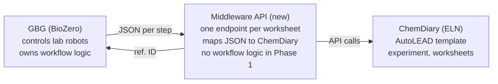

# AI AutoLEAD – ChemDiary Integration: Draft BRD

Draft of 24 Nov 2026.

AI AutoLEAD needs a middleware that lets the lab orchestration software (GBG) write experiment data into the ELN ChemDiary through one simple API call per workflow step, with no human data entry. This draft is based on the onboarding call of 13 Nov 2026 (transcript only) and is for review by the Tech Lead and Product Managers.

## 1. Purpose and background

- **Programme:** AI AutoLEAD builds a largely automated early-discovery lab that covers the full Design–Make–Test–Analyze cycle. Design is compound design, Make is chemistry/synthesis, Test is biology assays, and Analyze feeds results back into the next design.
- **What is new:** Test (biology) is already well automated at the site. The Make (chemistry) lab is the new part: two large Hamilton stores, plus reaction, work-up, purification and analytics stations.
- **The problem:** Every Make step must still be documented in the ELN. GBG (Green Button Go, the control software from the lab vendor BioZero) runs the physical workflow, but calling ChemDiary directly would need about 20 steps per worksheet and make GBG workflows unreadable.
- **The ask:** Build a middleware (working name "AutoLEAD–ChemDiary API") that GBG calls with structured JSON, and that translates each call into the multiple ChemDiary API calls needed to create and fill an experiment.
- **Starting point:** An AutoLEAD-specific ChemDiary template, built with the ChemDiary vendor, is reported to be 95–99% complete. Field mapping between GBG's data and the template is under way with the users.

## 2. Scope and phasing

Phase 1 is deliberately narrow: create the experiment and fill its worksheets from GBG data, with no business logic in the middleware.

| Phase | In scope | Notes |
| --- | --- | --- |
| 1 (now) | Create experiment from the AutoLEAD template; one simple API per worksheet (e.g. work-up) that accepts structured JSON and writes it to ChemDiary | Workflow logic stays entirely in GBG |
| 2 | Initiate analytical requests (offline analytics tasks) and return the purity result to GBG | Orchestrator then decides on compound registration and publishing |
| 3 | Event and notification callbacks back to GBG as required | Mechanism (direct response vs. webhook plus callback) to be agreed with BioZero |

**Out of scope for Phase 1:**

- Workflow orchestration or decision logic (owned by GBG).
- Any target system other than ChemDiary; this project covers the ChemDiary integration only.
- Review and signing of experiments, which the ChemDiary API does not cover per the call. Registration and publishing are expected to be automatic, with a reference to the responsible lab head agreed with the patent department.

## 3. Stakeholders and systems

| Name / system | Role | Notes |
| --- | --- | --- |
| Jan Heinrichs | Business lead, AutoLEAD (DE) | Owns template, user sessions and field mapping |
| Martin Trott | Technical / programme lead (DE) | Defines the middleware concept and scope |
| Second "Jan" (chemist user) | Business user | Will walk through the template manually; same first name as the lead, so use surnames in invites |
| Debosmita Bose | Product Owner (IN) | Translates this into user stories; coordinates developers |
| Gernot, Deepak | Technical contacts | Input on hosting and deployment of the middleware |
| GBG (Green Button Go) | Lab orchestration software | Provided by BioZero; calls our API |
| ChemDiary | Make-side ELN | Target system for this project |
| ChemDiary vendor | Template and API support | Referred to as "RAVI"/"Reviti" in the transcript; confirm exact name |
| Patent department | Governance | Agreed automatic registration/publishing with lab-head reference |

## 4. Business requirements

| ID | Requirement | Phase | Priority |
| --- | --- | --- | --- |
| BR-01 | GBG can create a ChemDiary experiment from the AutoLEAD template with one API call, and receive the experiment/notebook reference ID back | 1 | Must |
| BR-02 | GBG can populate each AutoLEAD worksheet (e.g. work-up) with one API call per worksheet using structured JSON | 1 | Must |
| BR-03 | The API fills all mandatory template fields and supports optional fields that depend on the reaction step | 1 | Must |
| BR-04 | Reaction scheme data (building blocks, reagents, solvents, products) reaches ChemDiary so reactant and product tables populate | 1 | Must |
| BR-05 | No manual data entry in ChemDiary during Make; entries are made without human interaction | 1 | Must |
| BR-06 | Field mapping between GBG data and the template is documented, with gaps and extra data sources identified | 1 | Must |
| BR-07 | The ELN reference ID is returned to GBG; the exact exchange pattern (synchronous reply, or webhook plus callback) is agreed with BioZero | 1 | Should |
| BR-08 | GBG can trigger analytical requests (tasks) for final compounds, and the resulting purity is returned to GBG | 2 | Should |
| BR-09 | Compound registration and publishing / experiment closure can be triggered automatically, with a lab-head reference | 2 | Should |
| BR-10 | Event notifications back to GBG where required | 3 | Could |
| BR-11 | Solution is deployable as a containerised service | 1 | Should |

## 5. High-level solution and data flow

GBG sends structured JSON per workflow step; the middleware turns each into the ChemDiary calls and returns the experiment reference ID. Phase 2 also returns the analytics purity result, and the exact return mechanism is still open (see BR-07).

## 6. Prerequisites

Development can start once the template is frozen, the field mapping is agreed and a ChemDiary dev environment is reachable.

| # | Prerequisite | View | Owner | Needed before |
| --- | --- | --- | --- | --- |
| P1 | Template walkthrough call with the business and the second Jan, covering a full run-through of all worksheets | Business | Debosmita, Jan H. | User stories |
| P2 | Final AutoLEAD template frozen (or change process agreed) | Business | Jan H. | Development |
| P3 | Field mapping: ChemDiary fields vs. data GBG holds; list of gaps and extra sources | Business | Jan H., users | API contract |
| P4 | Worked example of a manually filled experiment per worksheet, with expected values | Business | Second Jan | Test cases |
| P5 | Agreement on mandatory vs. optional fields per reaction step | Business | Jan H., users | API contract |
| P6 | Patent department decision on automatic registration/publishing and lab-head reference confirmed | Business | Jan H. | Phase 2 |
| P7 | Access to AutoLEAD Teams site and latest presentation deck | Business | Jan H. | Now |
| P8 | Agreed JSON input schema per worksheet and per create-experiment call | Technical | Martin, dev team | Development |
| P9 | ChemDiary dev environment and API credentials for the team | Technical | Martin, ChemDiary vendor | Development |
| P10 | ChemDiary API catalogue and call sequence per worksheet (about 2+ calls each) | Technical | Dev team, vendor | Estimation |
| P11 | GBG/BioZero interface agreement: sync response vs. webhook plus callback, auth, payload sizes, error handling | Technical | Martin, BioZero | Development |
| P12 | Hosting and deployment pattern (containers, scaling) | Technical | Gernot, Martin, Deepak | Development |
| P13 | Non-functional targets: availability, expected call volume, logging and audit trail | Technical | Tech Lead | Design |
| P14 | GBG test or sandbox endpoint to run end-to-end tests | Technical | BioZero | Integration test |

## 7. Assumptions, risks, open questions and next steps

**Assumptions**

- GBG holds the workflow logic and knows what was planned and which template applies; the middleware only relays and transforms data.
- The ChemDiary vendor's API catalogue covers everything needed except review/signing.
- Lab processes are harmonised enough that a fixed set of worksheets covers all reactions.

**Risks**

- GBG may not hold every field the template needs (e.g. building-block properties), so extra data sources may be required.
- Template changes after API design cause rework; the template is not yet frozen.
- Offline analytics currently needs a manual click in ChemDiary to retrieve data, which complicates Phase 2 automation.
- Scope will grow quickly beyond Phase 1; the team said it will "get complicated soon enough".
- Two people named Jan and unclear vendor names in the transcript risk confusion in invites and contracts.

**Open questions**

- Does GBG receive the experiment ID in the reply to the create call, or via a later callback?
- Who is the named lab head for automatic registration and publishing?
- What call volume and latency are expected per experiment?
- Which hosting and deployment pattern will the middleware use?

**Next steps**

1. Schedule the template walkthrough with the business (Debosmita to organise).
2. Debosmita to speak with Martin and Gernot on how the Leap-side deliverable is packaged.
3. Jan H. to request access for Debosmita to the AutoLEAD Teams site and share the latest presentation.
4. Call with Gernot, Martin and Deepak on hosting and deployment of the middleware.
5. Set up a regular stand-up once the walkthrough is done.
