# AI AutoLEAD – ChemDiary Integration: Project Timeline Plan

Draft of 24 Nov 2026.

## 1. Plan at a glance

The Phase 1 integration takes about 16 weeks from today across four phases: requirements (now), spikes and architecture, development, and rollout with final documentation.

```mermaid
flowchart LR
    P1["<b>Phase 1 (now)</b><br/>Requirements, 2 weeks<br/>BRD sign-off, field mapping<br/>Owner: PO"]
    P2["<b>Phase 2</b><br/>Spikes + arch, 2 weeks<br/>API and GBG spikes, architecture docs<br/>Owner: tech team"]
    P3A["<b>Phase 3: Template</b><br/>3 weeks<br/>Create experiment, return ref. ID<br/>Owner: dev team"]
    P3B["<b>Phase 3: Worksheets</b><br/>5 weeks<br/>Mandatory sheets, end-to-end tests<br/>Owner: dev team"]
    P4["<b>Phase 4</b><br/>Rollout + docs, 2 + 2 weeks<br/>Deploy phase 1, final documentation<br/>Owner: dev + Tech Lead"]
    P1 -->|"Gate: BRD signed off"| P2
    P2 -->|"Gate: arch docs approved"| P3A
    P3A -->|"Gate: experiment created"| P3B
    P3B -->|"Gate: worksheets filled"| P4
    P4 --> DONE(["Live and documented"])
```

Development is split into the template first, then the mandatory worksheets. Each phase closes at a gate that the Tech Lead and business confirm. The diagram is not to scale; durations are indicative and to be confirmed.

## 2. Phase details

Phase 1 (Make-side ChemDiary integration) runs in four phases, from requirements to documented rollout. Durations are indicative, in weeks from today, and need the Tech Lead's confirmation. Dates are not fixed yet.

| Phase | Goal | Key activities | Owner | Exit gate | Indicative duration |
| --- | --- | --- | --- | --- | --- |
| 1. Requirement gathering (now) | Agree what to build | Template walkthrough with business and the second Jan; field mapping GBG vs. ChemDiary; mandatory vs. optional fields; BRD review; user stories | Product Owner, Jan H. | BRD signed off; template frozen or change process agreed; field mapping complete | 2 weeks |
| 2. Spikes and prerequisite architecture docs | Remove technical unknowns for a simple REST API | Four spikes: (1) ChemDiary API can create an experiment and fill every block, including tables and the chromatogram file; (2) template automations and calculated fields; (3) how GBG calls the API and whether it needs the experiment ID in the same response; (4) authentication to ChemDiary and from GBG. Then OpenAPI spec and JSON schema; architecture doc covering hosting, deployment and network path | Tech team, Tech Lead | Spike results reviewed; OpenAPI spec agreed with BioZero; architecture doc approved; dev environment and credentials available | 2 weeks |
| 3a. Development: template | Create an experiment from the AutoLEAD template and return the reference ID | Create-experiment endpoint; header fields; reaction scheme tables; unit and contract tests | Dev team | Experiment created from GBG test call; ID returned | 3 weeks |
| 3b. Development: mandatory worksheets | Fill each mandatory worksheet with one call | One endpoint per mandatory worksheet (e.g. procedure, analytic); optional fields by reaction step; idempotency keys, validation and error handling; end-to-end tests with GBG sandbox | Dev team | All mandatory worksheets filled end to end for the agreed example runs | 5 weeks |
| 4. Deployment, rollout and final documentation | Go live for Phase 1 scope and hand over | Containerised deployment; rollout with GBG/BioZero; business acceptance on worked examples; then API reference, runbook, architecture and user documentation | Dev team, Tech Lead, business | Phase 1 live; documentation approved and handed over | 2 weeks rollout, then 2 weeks documentation |

Out of this plan: analytics requests, registration and publishing, and event notifications (project Phases 2 and 3).

## 3. Dependencies, risks and decisions needed

**Dependencies that gate a phase**

- Template freeze (Phase 1) gates the JSON schema (Phase 2) and all development.
- ChemDiary dev environment and API credentials gate the Phase 2 spikes.
- GBG/BioZero sandbox endpoint gates end-to-end tests in Phase 3b.
- Hosting pattern agreed with Gernot, Martin and Deepak gates deployment.

**Main schedule risks**

- Template changes after the schema is agreed cause rework in Phases 3a and 3b.
- GBG may not hold every field the template needs, which adds data-source work.
- Dependence on BioZero availability for the interface agreement and testing.
- Scope growth into analytics and registration before Phase 1 is live.

**Decisions needed from the Tech Lead**

1. Confirm or change the indicative durations and set start dates.
2. Confirm the order: Phase 2 spikes can start in parallel with the end of requirement gathering.
3. Agree the exit gate for each phase.
4. Name the owners for the architecture documents.
