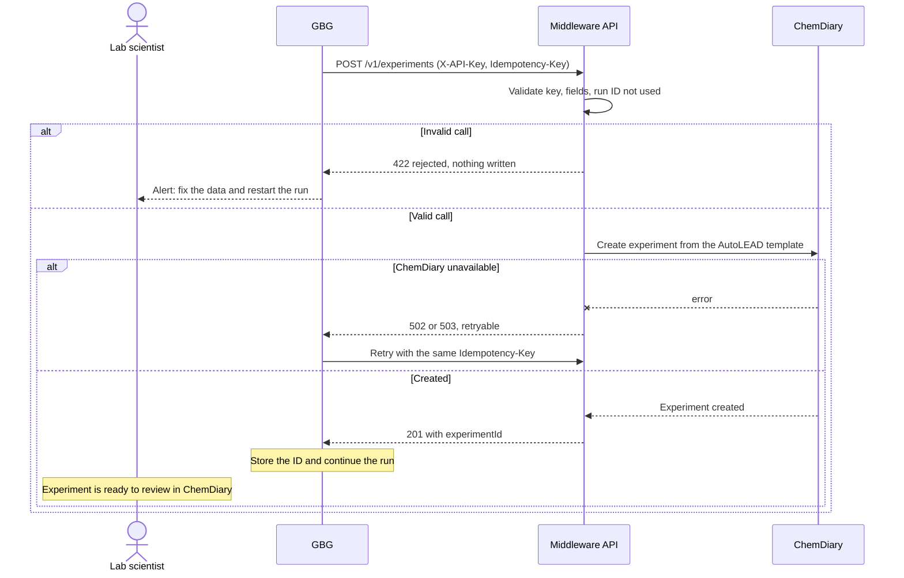
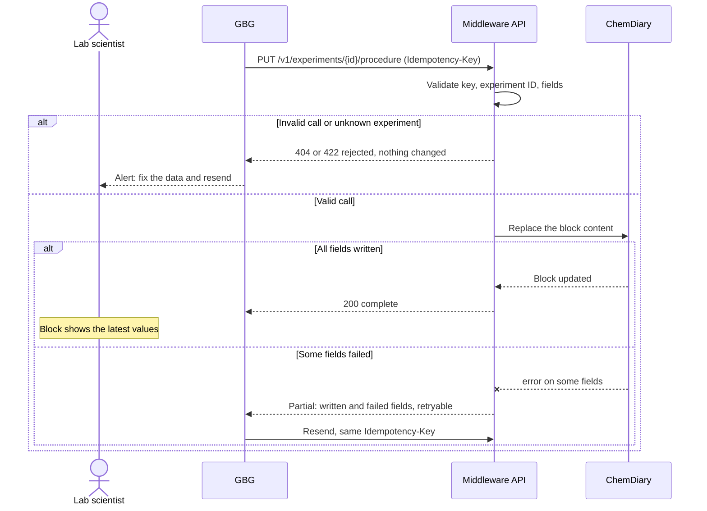
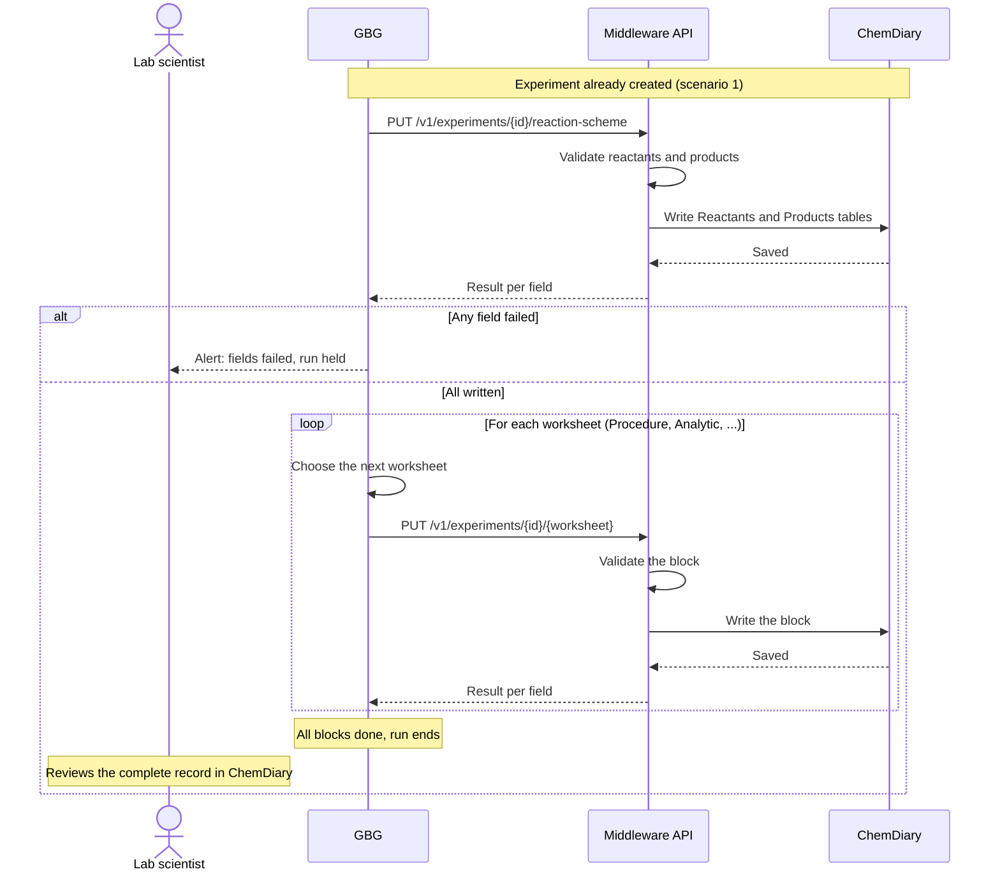

# AI AutoLEAD – ChemDiary Workflow Scenarios (Draft)

Draft of 26 Nov 2026.

Three scenarios show how GBG uses the ChemDiary API to create and fill AutoLEAD experiments, and how the business learns whether each step worked. The notification routes in section 5 are proposals; GBG's own alerting capabilities still need to be confirmed with Biosero.

## 1. Personas and context

| Persona or system | Role in these scenarios | What they care about |
| --- | --- | --- |
| Lab scientist (chemist) | Starts a synthesis run; reviews the ChemDiary experiment afterwards | The experiment is complete and correct without typing |
| Lab head | Accountable for the experiments; referenced for registration and publishing | Trustworthy records, clear exceptions |
| GBG (lab orchestration software) | Runs the robots; calls the API with JSON at each workflow step | A fast, clear answer: written, partly written, or rejected |
| ChemDiary middleware API | Validates the call, makes the ChemDiary calls, reports the result | No duplicate or half-filled experiments |
| ChemDiary (ELN) | Holds the AutoLEAD experiment and its blocks | Data lands in the right template blocks |
| Product owner and tech team (support) | Run and fix the service | Logs with a correlation ID, alerts on repeated failures |

Context for all scenarios: the AutoLEAD template has blocks for Reaction Scheme, Procedure, Analytic, Samples Table, Container table and Conclusion. GBG already knows the run's parameters, so no human types into ChemDiary during Make. Every write carries an `Idempotency-Key` and an `X-API-Key` header.

## 2. Scenario 1: GBG creates the experiment

A lab run starts, and GBG needs a new ChemDiary experiment from the AutoLEAD template.

**Success:** GBG receives the experiment ID, stores it and continues; the scientist later finds the experiment ready to review.

**Failure:** If the call is invalid (bad key, missing field, run ID already used), nothing is written. GBG gets a clear rejection and holds the run. If ChemDiary is unreachable, GBG gets a retryable error and sends the same call again with the same key; a repeat never creates a second experiment.

## 3. Scenario 2: GBG updates a template block or worksheet

Data changes during the run, for example a corrected procedure, and GBG re-sends one block. PUT replaces the whole block, so the call is safe to repeat.

**Success:** The block shows the latest values and GBG carries on.

**Failure:** An invalid call changes nothing. If some fields fail to write, the reply lists which were written and which failed, with a retryable flag, so GBG resends only what is needed.

## 4. Scenario 3: GBG fills the template, chooses a worksheet and fills it

After the experiment exists, GBG fills the reaction scheme, then picks each worksheet in turn (for example Procedure, then Analytic) and fills it.

**Success:** Every call returns written; when the last block is done, GBG ends the run and the scientist reviews a complete record.

**Failure:** After every call GBG reads the per-field result. Any failure holds the run and alerts the lab team before the next worksheet is started.

## 5. How the business is told: success and failure

The API always answers GBG with one of three outcomes. What the business sees depends on what GBG does with that answer, so the routes below are proposals to agree with Biosero and the lab.

| Outcome | API answer to GBG | What GBG should do | What the scientist or lab head sees | Support sees |
| --- | --- | --- | --- | --- |
| Complete | 200 or 201, status complete, experiment ID | Store the ID, continue the run | The experiment in ChemDiary with the block filled; no action needed | Log line with the correlation ID |
| Rejected | 400 or 422, status rejected, field and reason | Hold the run, show the reason to the operator | Alert: which field is missing or invalid, and that nothing was written | Log line; trend of rejection reasons |
| Partial or unavailable | 207-style partial, or 502/503, with the failed fields marked retryable | Retry the same call with the same key; alert if it still fails | Alert only after retries fail: which block, and that the experiment is incomplete | Alert on repeated failures with the correlation ID |

**Business-readable messages (proposed wording)**

- Success: "Experiment EXP-ID created and Procedure filled."
- Rejected: "Procedure not filled: field Role is missing. Nothing was written to ChemDiary."
- Failed after retries: "Analytic partly filled. Chromatogram could not be saved. Please check experiment EXP-ID."

**Principles**

1. The scientist is only interrupted by a failure that needs a decision. Successful steps stay silent.
2. Every message names the experiment, the block and the field.
3. A failed call never leaves a silent half-filled experiment: it is reported, and the run is held.
4. The ChemDiary experiment itself is the record: a block is either filled or not.

## 6. Open decisions

| # | Decision | Options | Owner |
| --- | --- | --- | --- |
| 1 | Who sends the alert to the lab team | GBG's own alerting (needs confirming with Biosero), or the middleware sends a message | Tech Lead, Biosero |
| 2 | Channel for alerts | GBG operator screen, email, or a team channel | Jan H., lab head |
| 3 | Who owns a held run | Lab scientist fixes the data, or support fixes the service | Business, Product Owner |
| 4 | How many retries before alerting | To agree with Biosero | Tech Lead |
| 5 | Which failures page support | Only repeated failures, or every ChemDiary outage | Tech Lead, Product Owner |
| 6 | Does a held run restart from the failed block or from the start | Resume the failed block (preferred, because writes are idempotent), or restart | Jan H., Biosero |
